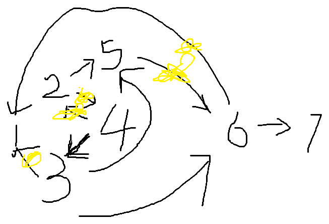

本场是 SMBC 冠名的 [AtCoder Beginner Contest 481](https://atcoder.jp/contests/abc481)。Rating **803 → 894（+91）**，Performance **1350**。A–E 五题、F/G 弃赛，终场前最后一版 E 存盘时比赛已经结束——差了 7 分钟。

**做题情况**（按剩余时间）

- 剩 1h38：A 过
- 剩 1h25：B 过
- 剩 1h20：C 过
- 剩 49min：D 过（手绘样例图见下）
- 剩 20min：E 第二版不完整（只写了读入和 k 的计算）
- 剩 10min：F 只剩空模板——「模拟完然后 dij？？数字会太长，拆位贡献？贪心吗？？没时间了呜呜」
- 剩 5min：E 三开，象限分类 + 叉积排序的第三版成型
- 终场铃响：E2 完整版存盘于结束之后 7 分钟

## A - Digits of A+B
https://atcoder.jp/contests/abc481/tasks/abc481_a

> **题意**：给定 $1 \sim 9$ 的整数 $A, B$，求 $A+B$ 的值是几位数。

**代码**

```cpp
#include <bits/stdc++.h>
using namespace std;
#define ll long long
const int maxn = 102;
int a,b;

//剩余 1h 38min

int main(){
	ios::sync_with_stdio(false);
	cin.tie(0);
	cin>>a>>b;
	if((a+b) >= 10) cout<<2;
	else cout<<1;
	return 0;
}
```

### 解读

$A+B \le 18$，只可能一位或两位——`>= 10` 分界，没有第三种情况。

## B - Polyline
https://atcoder.jp/contests/abc481/tasks/abc481_b

> **题意**：$xy$ 平面上有 $N$ 个点 $(i, A_i)$，依次连成一条折线。求折线上 $y$ 坐标恰好等于 $K$ 的点的个数（端点也计入；题目保证个数有限）。

**代码**

```cpp
#include <bits/stdc++.h>
using namespace std;
#define ll long long
const int maxn = 102;
int n,k;
int a[maxn];
int ans;

//剩余 1h 25min

int main(){
	ios::sync_with_stdio(false);
	cin.tie(0);
	cin>>n>>k;
	for(int i=1;i<=n;i++) cin>>a[i];
	int i = 2;
	if(a[1] == k) ans++;
	for(;i<=n;i++){//注意处理边界点 只统计完全闯过和在边界上面的贡献
		if(a[i] == k){
			ans++;
			continue;
		}
//		if((a[i] <= k && a[i-1] >= k) || (a[i] >= k && a[i-1] <= k)) ans++;
		if((a[i] < k && a[i-1] > k) || (a[i] > k && a[i-1] < k)) ans++;
	}
	cout<<ans;
	return 0;
}
```

### 解读

分类计数：起点命中 $K$ 计一次；之后每段线段，若 $A_{i-1}$ 与 $A_i$ 在 $K$ 异侧（严格穿越），线段与 $y=K$ 恰有一个交点，计一次；$A_i = K$ 的点本身也计一次（`continue` 前的分支）。注释里被划掉的「同侧夹逼」版本是等价的松约束写法——严格穿越才是准确的计数条件，改完就对了。

## C - Bank Accounts
https://atcoder.jp/contests/abc481/tasks/abc481_c

> **题意**：处理 $Q$ 次事件：每次给定名字 $s$——若该名字的账户已存在，输出其 ID；否则新开账户，分配「尚未使用的最小正整数」作为 ID 并输出。$Q \le 2 \times 10^5$，$|s| \le 10$。

**代码**

```cpp
#include <bits/stdc++.h>
using namespace std;
#define ll long long
const int maxn = 2e5+1;
int q,tot;
string s;
map<string,int> m;
//剩余 1h 20min

int main(){
	ios::sync_with_stdio(false);
	cin.tie(0);
	cin>>q;
	while(q--){
		cin>>s;
		auto it = m.find(s);
		if(it != m.end() && it->first == s) cout<<m[s]<<'\n';
		else m[s] = ++tot,cout<<tot<<'\n';
	}
	return 0;
}
```

### 解读

`map<string,int>` 一把梭。唯一的小陷阱是用 `m[s]` 直接访问会在 map 里插入零值——所以先 `find` 判断存在性，再决定是输出旧 ID 还是分配 `++tot`。

## D - Autopilot
https://atcoder.jp/contests/abc481/tasks/abc481_d

> **题意**：$N$ 颗行星、$M$ 条单向航路。飞船有两种操作：① 沿「编号最小的出边」免费移动；② 花 1 燃料移动到任意出边指向的行星。求 $S \to T$ 的最小燃料，不可达输出 $-1$。$N, M \le 2 \times 10^5$。

**代码**

```cpp
#include <bits/stdc++.h>
using namespace std;
#define ll long long
const int maxn = 2e5+1,maxm = 2e5+1;
int n,m,s,t;
int tot;
int head[maxn],nxt[maxm*2],to[maxm*2],vlu[maxm*2],dis[maxn];
void add(int u,int v,int w){
	to[++tot] = v;
	vlu[tot] = w;
	nxt[tot] = head[u];
	head[u] = tot;
}

//剩余 49min
//不是 这个题 案例是怎么输出1的？？
//哦 看错了 还以为一开始是t = 7 其实不是 唐了多花了这么久
//等一下发现 加0边没加上 回去查原因
//卧槽我是个傻逼写反比大小了 T_T

void dij(ll root){
	for(int i=1;i<=n;i++) dis[i] = INT_MAX - 1;
	priority_queue<pair<ll,ll> > q;
	dis[root] = 0;
	q.push({0,root});
	while(!q.empty()){
		ll curd = -q.top().first;
		ll u = q.top().second;
		q.pop();
		if(curd > dis[u]) continue;
		for(ll i=head[u];i;i=nxt[i]){
			ll v = to[i],w = vlu[i];
			//注意迪杰斯特拉需要先更新最短路再插入新节点 
			if(dis[v] > dis[u] + w){
				dis[v] = dis[u] + w;
				q.push({-dis[v],v});//注意此处插入的是 dis[v] 
			}
		}
	}
}

int main(){
	ios::sync_with_stdio(false);
	cin.tie(0);
	cin>>n>>m>>s>>t;
	for(int i=1;i<=m;i++){
		int u,v;
		cin>>u>>v;
		add(u,v,1);
	}
	//加上所有特殊边
	for(int i=1;i<=n;i++){
		int mindot = n+1;
		for(int j=head[i];j>0;j=nxt[j]){
			int v = to[j];
//			if(mindot < v) mindot = v;//我操 我是个傻逼 我他妈写反了 T_T
			if(mindot > v) mindot = v;
		}
		if(mindot == n+1) continue;
//		cout<<"the "<<i<<" is to "<<mindot<<'\n';//唐了这 怎么没加上啊
		add(i,mindot,0);
	}
	
	dij(s);
	if(dis[t] == INT_MAX - 1) cout<<-1;
	else cout<<dis[t];
	
	return 0;
}
```

赛时的手绘图（样例里从 2 出发：免费走 2→5→4→3，再花 1 燃料到 6→7，最后回到 1 的走法）：



### 解读与教训

正解是 **0/1 边权图上的 Dijkstra**：每个行星向「其出边中编号最小指向的行星」连一条 0 权边（免费操作），其余出边连 1 权边，跑最短路。

赛时连踩三坑，全在注释里留着案底：

1. **样例误读**：把初始的 `t = 7` 看成了别的值，对着样例愣了半天「怎么输出 1 的」。
2. **min 写反**：找最小编号出边时写成了求最大——`mindot > v` 写成 `mindot < v`。
3. **0 边漏连**：加了特殊边却忘了实际生效（回查才发现）。

三坑都爬出来了，剩 49 分钟收工。坑的共性：全是「赶」出来的——建图阶段放慢一分钟，三个坑一个都掉不进去。

## E - Most Brilliant Starry Sky
https://atcoder.jp/contests/abc481/tasks/abc481_e

> **题意**：平面上 $N$ 颗星（互不相同、任意两星与原点不共线）。过原点画一条不经过任何星的直线，把平面分成两半，选其中一侧，求该侧星数的最大值。$T$ 组数据，$\sum N \le 2 \times 10^5$。

**代码**（E2，赛后存盘的完整版）

```cpp
#include <bits/stdc++.h>
using namespace std;
#define ll long long
const int maxn = 2e5+1;
int t,n;
struct node{long long x, y;};

//剩余时间 5min 三开题目

long long cross(const node& a, const node &b) {return a.x * b.y - a.y * b.x;}

//机角区间 [0, pi) 返回 0 [pi, 2pi) 返回 1 为什么要这么写 是因为atan2会有精度问题
int check(const node& a) {
    if(a.y > 0 || (a.y == 0 && a.x > 0)) return 0;
    return 1;
}

bool cmp(const node& a,const node& b){//注意 对电机的排序需要处理边界值
	int ha = check(a);
	int hb = check(b);
    if (ha != hb) return ha < hb;
    return cross(a,b) > 0;
}

int main() {
    ios::sync_with_stdio(false);
    cin.tie(0);
    cin>>t;
	while(t--){
        cin>>n;
        vector<node> p(n+1);
        for (int i=1;i<=n;i++) cin>>p[i].x>>p[i].y;
//        sort(p.begin(),p.end(),cmp);
		sort(p.begin()+1,p.end(),cmp);//注意：：超绝忘记排序来袭！！
        vector<node> q(2*n+1);
        for (int i=1;i<=2*n;i++) q[i] = p[(i-1)%n+1];
        int ans = 0;
        int j=1;
        for (int i=1;i<=n;i++){
            if (j < i + 1) j = i + 1;
            while (j < i + n && cross(p[i],q[j]) > 0) j++;
            ans = max(ans,j - i);
        }
		cout<<ans<<'\n';
    }

    return 0;
}
```

### 解读

选直线二分星群 ≡ 找一条过原点的方向，使「某一侧」的点最多。标准做法三件套：

1. **极角排序**：所有星以原点为极点，按极角排成一圈。
2. **象限分类比较**：不用 `atan2`（浮点精度坑），按 `y > 0 || (y == 0 && x > 0)` 分两个半平面先比象限，同象限内用叉积比角度——注释里写得很清楚。
3. **倍长 + 双指针**：极角排序后的环倍长一遍，对每个起点 $i$，双指针 $j$ 找极角差 $< \pi$ 的最长连续段——段内点数就是「选这条直线一侧」的最大值。

赛时三次开题：第一版想用「同 $k$ 分组」（不对）；第二版尝试枚举 + 微扰（浮点误差，弃）；剩 5 分钟第三版定下极角排序方案——**存盘时终场铃已经响过**。完整实现赛后验证通过，思路是对的，输在启动太晚。

## F - Evil Shortest Path（未完成）
https://atcoder.jp/contests/abc481/tasks/abc481_f

> **简要题意**：$N$ 点 $M$ 边有向图，每条边标数字 $1 \sim 9$。沿边移动时把数字按顺序串接成整数作为「分数」（可重复走）。对每个 $v = 2 \dots N$，求 $1 \to v$ 的最小分数 $\bmod\ 998244353$。保证 1 可达全部顶点。$N, M \le 2 \times 10^5$。

**现状**：只剩头文件和邻接表模板。赛时剩 10 分钟的判断：「模拟完然后 dij？？数字会太长，可能会炸吧」「拆位贡献？贪心吗？？没时间了呜呜」——方向都没锁死，直接弃了。

## G - Half-Baked（未完成）
https://atcoder.jp/contests/abc481/tasks/abc481_g

> **简要题意**：$N$ 个煎饼，第 $i$ 个以各 1/2 概率取 $A_i$ 或 $B_i$。烤完后按大小升序从上往下堆成一摞，设从上数第 $k$ 个的大小为 $X_k$，求 $\left( \mathbb{E}[X_k] \times 2^N \right) \bmod 998244353$ 对每个 $k$ 的值。$N \le 1.2 \times 10^5$，$A_i < B_i < 998244353$。

**现状**：文件里还是 A 题的代码残留。赛时的判断：「多项式！！可惜我不会」「观察贡献 + 组合数？应该不需要 NTT」「N 这么大，要用 NTT no」——在多项式工具箱缺位的情况下直接放弃。

---

## 赛后总结

**成绩**：A–E 五题（450 + 525 = 975 分位），Rating **803 → 894（+91）**，Performance **1350**。A/B/C 20 分钟三连，D 在 50 分钟内连踩三坑全爬出来，E/F/G 时间耗尽弃赛。

**做得好的**：

- D 的「免费走最小编号出边」观察和 0 权边建图一步到位——Dijkstra 模板也顶住了两次手滑修正的折腾。
- E 剩 5 分钟的第三版（象限分类 + 叉积避 atan2）方向完全正确，赛后验证直接通过——极角排序这套组合拳第三次实战，比 SCP 那次的「枚举 + 微扰」成熟多了。
- Rating +91、Performance 1350，是近期质量最高的一场。

**不足**：

1. **E 启动太晚**：D 收工后先磨了 E 的第一、二版（共约 30 分钟），剩 5 分钟才转向正确方向。D 用掉 50 分钟是上一题三坑的连锁反应——如果 D 一遍过，E 有完整的一小时，450 分就稳了。
2. **F 的 10 分钟**：空模板之外什么都没留下。「数字串联的最短路」其实有明确的拆位/状态设计方向，但赛时没敢展开——不熟悉的知识点，弃赛本身没错，错在弃得没有记录。
3. **G 类多项式题是知识盲区**：NTT/组合数工具箱缺位，列入补题计划。

**下一场的目标**：D 题级别的 400 分题一遍过（本场差一点做到了），E/F 至少留出 30 分钟完整时间——两个 450+ 的题都在最后 40 分钟里翻的车。