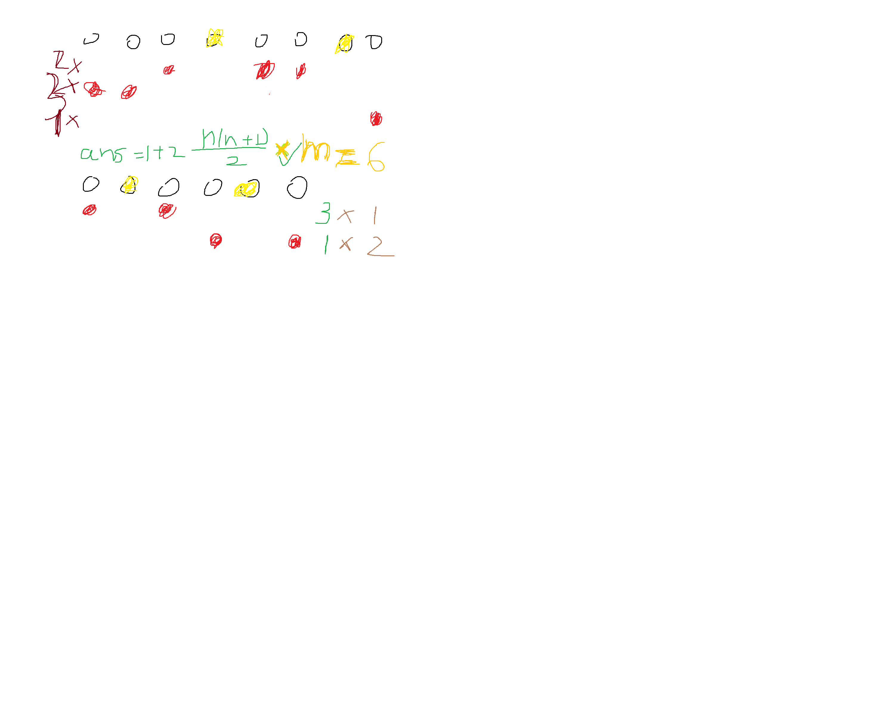

比赛时间：2026-10-17 下午（洛谷 [LGR-307](https://www.luogu.com.cn/contest/358588) · OI 赛制 · 4 题）。这场是 SCP 2026 复赛 S 组的全真模拟，题目为认证题，**原题面需要洛谷登录可见**，本文每题只写简要题意（凭赛时记录与代码概括）+ 做法复盘。

**排名情况**：洛谷榜单登录可见，得分待补。可确认的部分：A 过大样例 + 对拍（大概率通过），B 写完了正解框架但没验证，C 的建模大概率理解偏了，D 只交了部分分做法。

**做题情况**（按剩余时间）

- 剩 3h45：A 画图推公式（手绘图见下）
- 剩 2h54：A 主体写完，小样例通过
- 剩 2h29：大样例偏大 → 发现 a 没排序（第 0 次操作），sort 后过大样例
- 剩 2h20：大样例对拍通过，A 收工
- 剩 2h04：B 开题，n³ 暴力先落地
- 剩 1h37：B 走进拆位
- 剩 1h13：B 发现 OR 的单调性（固定 r 只有约 30 段）
- 剩 56min：B 的 OR 段维护 + mex 拆位统计实现，「好难 我要死了」
- 剩 43min：C 不会分析复杂度，先写暴力（BFS 数层级）
- D：力竭，小 n 爆搜 + 0/1 快判 + 大 n 输出上界
- 没看到比赛已经结束

## A - 档案 / file（P17722）
https://www.luogu.com.cn/problem/P17722

> **简要题意**（概括）：n 份档案排成一排、m 轮操作。基础总代价是 $1+2+\dots+n$ 乘以 $m$；第 $i$ 轮给出 $l_i$ 个询问值 $b$，每个 $b$ 的额外代价是排好序后严格大于它的档案数。轮次可以自由重排，轮内 $b$ 的顺序也可以重排，最小化总代价。（概括不保证逐字准确，原题面登录可见。）

**代码**

```cpp
#include <bits/stdc++.h>
using namespace std;
#define ll long long
const int maxn = 1e6+1;
ll n,m;
ll a[maxn],bvlu[maxn];
ll ans;

int main(){
  cin>>n>>m;
  for(int i=1;i<=n;i++) cin>>a[i];
  sort(a+1,a+1+n);//阴

  ans = 1LL * n * (n + 1) / 2;
  ans *= m;

  for(int i=1;i<=m;i++){
    int l,b;
    cin>>l;
    for(int j=1;j<=l;j++){
      cin>>b;
      ll vlu = (a+1+n) - lower_bound(a+1,a+1+n,b);
      bvlu[i] += vlu;
    }
  }

  sort(bvlu+1,bvlu+1+m);
  for(int i=1;i<=m;i++) ans += bvlu[i] * 1LL * (m - 1LL * i + 1LL);

  cout<<ans;
  return 0;
}
```

### 做法与教训

赛时的画图推导（就是这张手绘图，圆圈是档案，红圈是额外代价，绿色是公式）：



拆解出来是两层贪心：

1. **基础部分**：不管怎么操作，$1+2+\dots+n$ 每轮都在，即 $n(n+1)/2 \times m$ 先拿死。
2. **额外部分**：第 $i$ 轮里每个询问值 $b$ 的代价 = 排好序后严格大于 $b$ 的元素个数，用排序后后缀计数 $O(\log n)$ 求出每轮的 $bvlu_i$；轮次可重排，由排序不等式把 $bvlu$ **升序**配最大的系数，即 `ans += bvlu[i] * (m - i + 1)`。

赛时两个坑全踩了又都爬出来了：大样例偏大 → 发现 $a$ **初始无序**要先 sort；担心爆 long long → 算了一下 $n(n+1)/2 \times m$ 与 $bvlu \times m$ 的量级，$10^{18}$ 内装得下。教训是「先 sort」这种题面隐含步骤，靠大样例兜底不如开题时就把数据浇进去想一遍。

## B - 函数 / func（P17723）
https://www.luogu.com.cn/problem/P17723

> **简要题意**（概括）：给定长 $n$（$n \le 2 \times 10^6$）的非负整数数组，求 $\sum_{l \le r} f(l, r)$，其中 $f(l, r) = \mathrm{OR}(l, r)\ |\ \mathrm{mex}(l, r)$，OR 为区间按位或，mex 为区间内未出现的最小非负整数。

**代码**（节选，完整见文末文件）

```cpp
void solve1(){//最简单不过脑子的模拟 O(n^3)
  for(int l=1;l<=n;l++)
    for(int r=l;r<=n;r++){
      ull res = 0; set<int> S;
      for(int i=l;i<=r;i++) res |= a[i],S.insert(a[i]);
      ull mex = 0;
      while(S.count(mex)) mex++;
      ans += res | mex;
    }
}

void solve2(){
  vector<pair<ull,ull>> cur,nxt;
  for(int r=1;r<=n;r++){                      // OR 段维护：固定 r，每个 l 的 OR 值
    nxt.clear();
    nxt.push_back(make_pair(a[r],1ULL));      // 只有 O(log V) 段
    for(int i=0;i<(int)cur.size();i++){
      ull nv = cur[i].first | a[r];
      ull c  = cur[i].second;
      if(nxt.back().first == nv) nxt.back().second += c;
      else nxt.push_back(make_pair(nv,c));
    }
    cur = nxt;
    for(int i=0;i<(int)cur.size();i++) ans += cur[i].first * cur[i].second;
  }
  /* 再对每一位 k 单独扫一遍：
     双指针维护「区间内值 < 2^k 的互异个数」，
     当它恰好等于 2^k 时，mex 的第 k 位为 1，
     对该位贡献 2^k * (满足条件的区间数) */
}
```

### 做法与教训

这场最硬的一题，赛时走了三个弯路又拐回来三次：

1. 先猜 mex 对 OR 没影响（`x | x = x`，把整体拆成 OR 的「|和」与 mex 的「|和」）——写小程序验证时发现**题目要的是 `+` 不是 `|`**，推倒。
2. 拆位：从二进制角度看，mex 只有在出现超过 OR 最高位的 1 时才有额外贡献。方向对了，但一开始还在想把 OR 和 mex 分别求出来。
3. 关键转折：**OR 是单调的**。固定右端点 $r$，左端点从 $r$ 往左扫，$\mathrm{OR}(l,r)$ 的取值只有约 $\log V \approx 30$ 段。倒序枚举 $r$，维护「(OR 值, 左端点个数)」的段向量，新来一个 $a_r$ 就把所有段的值 `| a_r` 再合并相同相邻段——OR 部分的贡献 $O(n \log V)$ 解决。

mex 部分同样拆位：mex 第 $k$ 位为 1 等价于「区间内 $[0, 2^k)$ 的值全部出现过」。对每个 $k$ 用双指针维护「值小于 $2^k$ 的互异值个数」，数出满足条件的区间数乘上 $2^k$ 累加。两个循环都是 $O(n \log V)$。

遗憾在于这一整套写完了，**但没时间造数据验证正确性**——尤其「段数合并时相等的 OR 值要累加个数」这类边界。赛后教训：正解框架在剩 1 小时才成型时，应该先交一发用部分分验证方向，而不是闷头写到结束。

## C

> **简要题意**（概括，大概率有偏差）：给一张 $n$ 点 $m$ 边的无向图，从 1 号点出发，问能到达的点里**不同的最短距离层数**有多少。

**代码**（节选）

```cpp
void solve1(int n,int m){
  /* 建图后从 1 开始最短路：
     每次「第一次弹出某个距离值」时 C++，
     统计可达点里互异距离的个数 */
  priority_queue<pair<int,int>> pq;
  pq.push({0,-1});
  ll C = 0;
  while(!pq.empty()){
    auto pr = pq.top(); pq.pop();
    int delta = pr.first, u = -pr.second;
    if(delta != d[u]) continue;
    C++;
    for(int v : G[u]) if(d[v] > d[u]+1){ d[v] = d[u]+1; pq.push({d[v],-v}); }
  }
  cout<<C<<"\n";
}
```

### 做法与教训

剩 43 分钟时 B 刚落地，C 的题面读下来「3.5 秒时限 + 提到奇怪的松弛」——当时判断正解不是暴力 BFS 数层级，但已经没时间重新建模，决定先按「BFS 数层级」写一版保底。大样例没过（或与预期不符），赛后回看大概率是**建模阶段就理解偏了**，不是实现问题。

教训：**卡在建模时的正确动作是重读题面 + 找题面里的暗示词**（时限、值域、特殊性质都在提示方向），而不是先写一个「大概是这个意思」的暴力占坑——占坑本身花了十几分钟，还没有验证价值。

## D

> **简要题意**（概括）：给定序列 $a$（带特殊性质：$a_n = 0$ 且单调不减的变体），每次操作选一个前缀长度 $p$ 和一个值 $x$，把 $a_1..a_p$ 全部异或上 $x$。求使整个序列单调不减的最少操作次数。

**代码**（节选）

```cpp
// 候选 x 收敛：要么把某个 a[i] 异或成 0（x = a[i]），
// 要么把它变成数组里另一个存在的值（x = a[i] ^ a[j]），
// 异或出数组里没有的值不会更优 —— 有点像线性基的候选集思想

bool check01(){                       // ans = 0 / 1 的快速判定
  int c = 0, msk = 0;
  for(int i=1;i<n;i++){
    if(a[i] == a[i+1]) continue;
    int k = 29;
    while(k >= 0 && ((a[i]>>k)&1) == ((a[i+1]>>k)&1)) k--;   // 相邻最高异位
    /* a[i]^c < a[i+1]^c 当且仅当 c 的第 k 位等于 a[i] 的第 k 位，
       每对约束落在同一位上冲突则 ans=1 无解 */
    ...
  }
}

bool dfs(int d,int lm){               // 小 n 爆搜
  if(check()) return 1;
  if(d==lm) return 0;
  for(int p=1;p<=n;p++)
    for(int k=0;k<xn;k++){
      int x = xs[k];
      if(!x) continue;
      for(int i=1;i<=p;i++) b[i]^=x;
      if(dfs(d+1,lm)) return 1;
      for(int i=1;i<=p;i++) b[i]^=x;
    }
  return 0;
}
```

### 做法与教训

开场就「真没啥思路，暴力感觉也写不出来」——突破口有两个：

1. **候选 $x$ 收敛**：最优解里的 $x$ 只需要考虑 $a_i$ 和 $a_i \oplus a_j$ 两类（异或出数组里没有的值可以替换成这两类之一而不劣），有点线性基筛选候选元的味道。
2. **0/1 快判**：答案 0 = 本来非降；答案 1 = 存在 $c$ 使整段异或 $c$ 后非降——对每对相邻元素找最高异位 $k$，比较结果由 $c$ 在第 $k$ 位的取值决定，逐对约束冲突检测即可。

两个快判都写了，但「答案 ≥ 2 怎么搜」没落地，最后输出上界 $n$。更扎心的是**写完才发现比赛已经结束**——D 的提交根本没交上去。

---

## 赛后总结

4 题里 A 完整拿下（大样例 + 对拍双验证），B 正解框架写完没验证，C 建模跑偏，D 只交了部分分做法，终局还错过了提交时间。

**做得好的**：

- A 的路线是标准的「画图找规律 → 数学直觉 → 小样例 → 大样例 → 对拍」，全链路验证一步没省，手绘推导直接变成了证明（见上图）。
- B 的两个关键性质（OR 单调段、mex 拆位计数）都是自己推出来的，尤其「固定 $r$ 后 OR 只有 $O(\log V)$ 段」这个经典技巧能现场认出来，说明题单没白刷。

**不足**：

1. **B 的验证缺位**：正解框架剩 1 小时才成型，写完没有造小数据跑对拍就进入下一题。这类「实现完但正确性未验证」的题，赛后得分是未知数。
2. **C 的建模跑偏没被纠正**：3.5 秒时限和「松弛」的提示都在指向别的方向，但选择先写暴力占坑——占坑花的时间不少，还没有验证价值。规则同前：卡建模超过 20 分钟，重读题面找暗示词。
3. **D 的时间管理事故**：「没看时间比赛已经结束了」。最后阶段的正确动作是先把已有部分分提交掉，再看还能不能加东西；D 的爆搜和 0/1 判定全写完了却可能没换来分数。
4. 拆位 + 值域收敛（候选 $x$ 只有两类）这套组合拳本场出现了两次（B 和 D），方向感是对的——下次要练的是**更快地把它形式化成可验证的判定**，而不是在收敛前先耗掉半小时。

得分与排名：洛谷登录可见，待补。